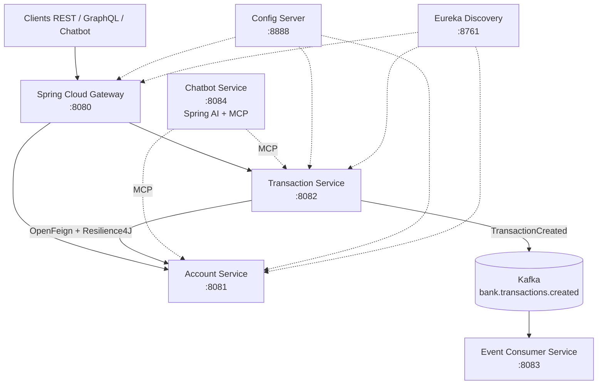

# Plateforme bancaire microservices — Test technique ADRIA / ENSET PFE 2027

Plateforme bancaire conçue autour de microservices Spring Boot. Le projet couvre la gestion des comptes et des transactions, la communication inter-services, la découverte et la configuration centralisées, la messagerie asynchrone avec Kafka, un chatbot agentique connecté à des outils MCP et une expérimentation de détection de fraude en Python.

**Réalisé par :** Houda El Jirari  
**Contexte :** Test technique — Architecture microservices, IA et développement full-stack

---

## Sommaire

- [Architecture](#architecture)
- [Technologies](#technologies)
- [Microservices et responsabilités](#microservices-et-responsabilités)
- [Règles métier](#règles-métier)
- [Communication et résilience](#communication-et-résilience)
- [Chatbot agentique et MCP](#chatbot-agentique-et-mcp)
- [Communication asynchrone avec Kafka](#communication-asynchrone-avec-kafka)
- [Détection de fraude](#détection-de-fraude)
- [Prérequis](#prérequis)
- [Lancement](#lancement)
- [Endpoints et tests](#endpoints-et-tests)
- [Limites et périmètre](#limites-et-périmètre)
- [Structure du dépôt](#structure-du-dépôt)

---

## Architecture

Le système s'appuie sur deux microservices métier (`account-service` et `transaction-service`), exposés directement ou via Spring Cloud Gateway. Eureka assure la découverte des services et Config Server centralise la configuration.



Les interfaces REST, GraphQL et MCP des services métier s'appuient sur une même couche de service afin de centraliser les règles métier.

## Technologies

| Domaine | Technologies |
|---|---|
| Langage | Java 17 |
| Framework backend | Spring Boot 3.4.5 |
| Écosystème distribué | Spring Cloud 2024.0.1 |
| Communication synchrone | REST, OpenFeign |
| API | Spring GraphQL |
| Découverte et configuration | Eureka, Spring Cloud Config |
| Résilience | Resilience4J (Circuit Breaker, Retry) |
| IA et outils | Spring AI 1.0.0, MCP |
| Messagerie | Apache Kafka |
| Persistance | Spring Data JPA, H2 |
| Build | Maven multi-modules |
| Détection de fraude | Python, pandas, scikit-learn |
| Conteneurisation | Docker Compose pour Kafka |

## Microservices et responsabilités

| Service | Port | Responsabilité |
|---|---:|---|
| `config-service` | 8888 | Configuration centralisée |
| `discovery-service` | 8761 | Découverte des services avec Eureka |
| `gateway-service` | 8080 | Point d'entrée et routage vers les services métier |
| `account-service` | 8081 | Création, consultation et gestion des comptes |
| `transaction-service` | 8082 | Création et consultation des transactions, vérification des règles métier |
| `event-consumer-service` | 8083 | Consommation et journalisation des événements Kafka |
| `chatbot-service` | 8084 | Agent conversationnel utilisant Spring AI et MCP |

### Account Service

Un compte contient notamment :

- `id` : identifiant UUID ;
- `customerReference` : référence client ;
- `status` : `ACTIVE` ou `BLOCKED` ;
- `currency` : devise du compte ;
- `balance` : solde.

Le service expose des opérations REST, GraphQL et MCP. La couche métier prend également en charge le virement entre deux comptes, avec vérification de leur état, de la devise et du solde disponible.

### Transaction Service

Le service permet de créer et de consulter des transactions. Il vérifie les règles métier avant l'enregistrement et met à jour le solde du compte concerné.

Une transaction contient notamment un identifiant, un compte associé, un montant, une devise, une catégorie commerçant, un pays et une date de création.

## Règles métier

Les contrôles appliqués lors de la création d'une transaction sont :

1. Le montant doit être strictement positif.
2. Le montant ne doit pas dépasser le plafond configuré `bank.transaction.max-amount` (valeur : `1000`).
3. Le compte doit exister et être actif.
4. La devise de la transaction doit correspondre à celle du compte.
5. Le solde est consulté avant l'opération, puis mis à jour après l'enregistrement de la transaction.

Le service de configuration partage notamment le paramètre `bank.transaction.max-amount=1000`.

## Communication et résilience

`transaction-service` communique avec `account-service` à l'aide d'OpenFeign (`AccountClient`), avec résolution du service via Eureka.

L'appel est protégé par Resilience4J :

- **Circuit Breaker** pour limiter les appels à un service indisponible ;
- **Retry** avec trois tentatives et un délai de 500 ms ;
- méthode de repli renvoyant une erreur HTTP `503` explicite lorsque `account-service` est indisponible ;
- une erreur `404` correspondant à un compte inconnu n'ouvre pas le circuit.

## Chatbot agentique et MCP

Le `chatbot-service` utilise Spring AI avec un modèle LLM accessible via Groq (`llama-3.3-70b-versatile`).

Il se connecte aux serveurs MCP d'`account-service` et de `transaction-service`. Le modèle choisit les outils à appeler en fonction de la demande de l'utilisateur.

**Endpoint :** `POST http://localhost:8084/chat`

Exemple de corps JSON :

```json
{
  "message": "Liste tous les comptes bancaires"
}
```

La clé API est fournie à l'exécution par une variable d'environnement et ne doit pas être commitée dans le dépôt.

## Communication asynchrone avec Kafka

Après l'enregistrement réussi d'une transaction :

1. `transaction-service` publie un événement `TransactionCreated`.
2. L'événement est envoyé dans le topic `bank.transactions.created`.
3. La clé du message est l'`accountId`, afin de conserver l'ordre des événements d'un même compte dans une partition.
4. `event-consumer-service` consomme et journalise l'événement, sans modifier les données bancaires.

## Détection de fraude

Le volet Python est implémenté dans `fraud-detection/fraud_detection.py`.

### Démarche

- Chargement et exploration du jeu de données ;
- analyse de la proportion de fraudes et des valeurs manquantes ;
- séparation entraînement/test stratifiée (80 % / 20 %) ;
- exclusion des identifiants ;
- pipeline de prétraitement comprenant imputation, encodage One-Hot et normalisation ;
- ajustement du prétraitement uniquement sur les données d'entraînement ;
- entraînement d'une régression logistique avec `class_weight="balanced"` ;
- sélection du seuil de décision par validation croisée sur l'entraînement ;
- évaluation finale sur le jeu de test.

### Résultats rapportés

Le jeu de données contient **5 000 transactions**, dont **5,14 % de fraudes**. Sur la classe fraude, le modèle obtient :

| Métrique | Résultat |
|---|---:|
| Précision | 0,208 |
| Rappel | 0,196 |
| F1-score | 0,202 |
| Seuil retenu | 0,776 |

Sur les 51 fraudes du jeu de test, 10 sont détectées et 41 ne le sont pas ; le modèle génère également 38 faux positifs.

Ces résultats restent insuffisants pour un usage réel. L'accuracy de 92,1 % est peu représentative dans ce contexte déséquilibré et est inférieure à celle d'un classifieur prédisant systématiquement la classe majoritaire (94,9 %). La précision, le rappel et le F1-score de la classe fraude sont donc plus pertinents pour analyser ce modèle.

## Prérequis

- JDK 17 ;
- Maven ;
- Docker Desktop (pour Kafka) ;
- Python 3.10 ou supérieur (pour la partie détection de fraude) ;
- une clé API Groq pour utiliser le chatbot.

## Lancement

Les commandes suivantes sont à exécuter depuis la racine du dépôt, dans des terminaux séparés pour les services qui doivent rester actifs.

### 1. Démarrer Kafka

```powershell
docker compose -f infra/docker-compose-kafka.yml up -d
```

### 2. Compiler le projet

```powershell
mvn clean compile
```

### 3. Démarrer les microservices

Démarrer les services dans l'ordre suivant :

```powershell
mvn -pl config-service spring-boot:run
```

Dans un autre terminal :

```powershell
mvn -pl discovery-service spring-boot:run
```

Puis démarrer les services métier et techniques, chacun dans son propre terminal :

```powershell
mvn -pl account-service spring-boot:run
```

```powershell
mvn -pl transaction-service spring-boot:run
```

```powershell
mvn -pl gateway-service spring-boot:run
```

```powershell
mvn -pl event-consumer-service spring-boot:run
```

Pour le chatbot, définir d'abord la variable d'environnement `GROQ_API_KEY`, puis lancer :

```powershell
mvn -pl chatbot-service spring-boot:run
```

Exemple PowerShell pour définir la variable dans le terminal courant :

```powershell
$env:GROQ_API_KEY = "VOTRE_CLE_API"
```

Ne jamais remplacer cette variable par une clé réelle dans le README ou dans un fichier versionné.

## Endpoints et tests

Le fichier [`docs/requests.http`](docs/requests.http) regroupe les requêtes de test destinées à un client HTTP, notamment celui d'IntelliJ IDEA.

| Fonction | Endpoint |
|---|---|
| Créer / lister les comptes | `http://localhost:8081/api/accounts` |
| Créer / lister les transactions | `http://localhost:8082/api/transactions` |
| Comptes via la Gateway | `http://localhost:8080/api/accounts` |
| Transactions via la Gateway | `http://localhost:8080/api/transactions` |
| GraphiQL — Account Service | `http://localhost:8081/graphiql` |
| MCP SSE — Account Service | `http://localhost:8081/sse` |
| MCP SSE — Transaction Service | `http://localhost:8082/sse` |
| Chatbot | `POST http://localhost:8084/chat` |

### Exemples REST

Créer un compte :

```bash
curl -X POST http://localhost:8081/api/accounts \
  -H "Content-Type: application/json" \
  -d '{"customerReference":"CUST-001","currency":"EUR","balance":500}'
```

Créer une transaction (remplacer `<ACCOUNT_ID>` par l'identifiant d'un compte existant) :

```bash
curl -X POST http://localhost:8082/api/transactions \
  -H "Content-Type: application/json" \
  -d '{"accountId":"<ACCOUNT_ID>","amount":100,"currency":"EUR","merchantCategory":"FOOD","country":"MA"}'
```

Interroger le chatbot :

```bash
curl -X POST http://localhost:8084/chat \
  -H "Content-Type: application/json" \
  -d '{"message":"Liste tous les comptes bancaires"}'
```

## Limites et périmètre

- Le client web ou mobile prévu dans le sujet n'a pas été traité.
- La partie DevOps est partielle : Kafka est lancé avec Docker Compose. Le rapport présente également des réponses de conception concernant les secrets, les contrôles de santé, l'observabilité et les stratégies de rollback ; cela ne signifie pas que l'ensemble de ces mécanismes a été déployé.
- Keycloak et l'authentification centralisée ne sont pas mis en place dans cette version.
- Le modèle de détection de fraude est expérimental et ses performances ne permettent pas un usage en production.

## Structure du dépôt

```text
.
├── account-service/
├── transaction-service/
├── gateway-service/
├── discovery-service/
├── config-service/
├── chatbot-service/
├── event-consumer-service/
├── fraud-detection/
│   └── fraud_detection.py
├── infra/
│   └── docker-compose-kafka.yml
├── docs/
│   └── requests.http
└── pom.xml
```
